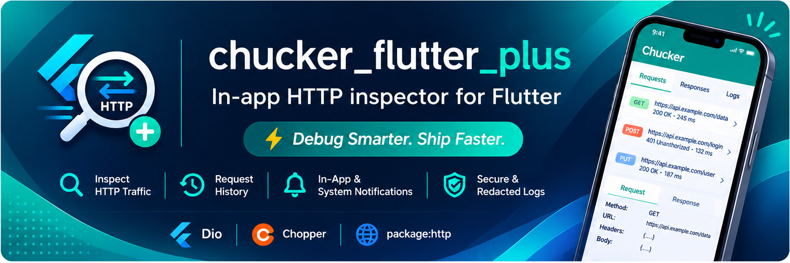

# Chucker Flutter Plus



Chucker Flutter Plus is an in-app HTTP inspector with local history, foreground
banners, and optional system notifications. Capture traffic from Dio and
`package:http`, or log to the console from Dio, Chopper, and `package:http`.
Each integration can be used independently.

## Quick start

Use Flutter 3.47.2 or later with Dart 3.13.2 or later.

```sh
flutter pub add chucker_flutter_plus dio
```

```dart
import 'package:chucker_flutter_plus/chucker_flutter_plus.dart';
import 'package:dio/dio.dart';
import 'package:flutter/material.dart';

Future<void> main() async {
  await Inspector.init();
  final dio = Inspector.attachDio(Dio());
  runApp(
    MaterialApp(
      navigatorKey: Inspector.navigatorKey,
      home: Scaffold(
        appBar: AppBar(
          title: const Text('Network demo'),
          actions: [Inspector.button()],
        ),
        body: Center(
          child: FilledButton(
            onPressed: () async {
              await dio.get<void>('https://jsonplaceholder.typicode.com/posts/1');
            },
            child: const Text('Send request'),
          ),
        ),
      ),
    ),
  );
}
```

Use the same key on your router's root `Navigator` with `MaterialApp.router`.
If your app already owns a key, pass it to `Inspector.init(navigatorKey: key)`.
Open history from any widget with `Inspector.show(context)`, or use
`Inspector.show()` after the key is mounted. Existing callers can keep
`ChuckerDioInterceptor()`, `ChuckerFlutterPlus.initialize()`, and
`ChuckerFlutterPlus.navigatorObserver`.

### Capture with package:http

Add `http` with `flutter pub add http`, initialize the inspector as above, and
keep the wrapped client for the lifetime of your API service.

```dart
import 'package:chucker_flutter_plus/chucker_flutter_plus.dart';
import 'package:http/http.dart' as http;

Future<http.Response> fetchPost() async {
  final client = Inspector.attachHttp(http.Client());
  try {
    return await client.get(
      Uri.parse('https://jsonplaceholder.typicode.com/posts/1'),
    );
  } finally {
    client.close();
  }
}
```

`Inspector.attachHttp` also accepts a custom HTTP client. Closing the wrapper
closes that client. For `send`, the response remains streamed and is recorded
when the caller finishes reading it or receives a stream error. Unread or
cancelled responses may have no entry. Dio's `ResponseType.stream` records
metadata when Dio returns the stream. Streaming uploads are captured as
metadata when their contents are unavailable without reading them.
The underlying client handles HTTP compression and decompression.

Skip inspector capture for one request with
`Options(extra: {ChuckerDioInterceptor.disableCaptureExtraKey: true})` in Dio,
or set `ChuckerHttpClient.disableCaptureHeader` to `'true'` in
`package:http`. The HTTP wrapper removes the control header before sending.

## Notifications and history

```dart
import 'package:chucker_flutter_plus/chucker_flutter_plus.dart';

Future<void> configureInspector() => Inspector.init(
  config: InspectorConfig(
    maximumEntries: 150,
    retention: const Duration(days: 3),
    maximumBodyBytes: 32 * 1024,
    showStatusBarNotification: true,
    statusBarWhileForeground: false,
    notifyOnlyOnError: true,
    notificationFilter: (transaction) => transaction.uri.host == 'api.example.com',
  ),
);
```

- With `Inspector.init()`, capture runs in debug builds, shows in-app banners
  in the foreground, and retains up to 100 entries for seven days. System
  notifications are opt-in.
- When system notifications are enabled, background completions use a single
  grouped notification with at most one update every two seconds. In the
  foreground, banners take priority unless `statusBarWhileForeground` is
  enabled. With banners turned off, the system notification is used in both
  states. Notification taps and banners use the app's root navigator.
- The error filter matches HTTP 4xx/5xx and transport or stream failures. The
  optional predicate also has to match. It sees redacted data.
- A tap opens the transaction associated with the posted notification. If that
  entry expired or was deleted, the inspector opens history. System
  notifications require a running Flutter engine to observe new requests.
- Set `requestNotificationPermission: false` if your app manages prompting.
  Permission denial or a platform notification failure leaves capture available.
- Use `Inspector.updateConfig(config)` to change settings on a running app.
  `Inspector.init` applies the supplied defaults at startup. The Settings screen
  can adjust display preferences and the history limit during the session.
  Call `Inspector.dispose()` when a host tears down the inspector.

| Platform | Inspector and console | OS notifications |
| --- | --- | --- |
| Android | Available | Requires notification permission on Android 13+. Use the default launcher mipmap or configure `androidNotificationIcon` with your drawable resource. |
| iOS and macOS | Available | Requires user permission and the host app's notification delegate setup. |
| Linux | Available | Requires a desktop notification daemon. Taps on a running app depend on daemon support for actions. Launch on tap is unavailable. |
| Windows | Available | In-app banners are available. |
| Web | Console is available. Inspector history uses browser-local Hive storage where IndexedDB is available. | In-app banners are available. |

For native notification setup, including Android Gradle requirements and the
Apple notification delegate, follow the
[flutter_local_notifications platform instructions](https://pub.dev/packages/flutter_local_notifications/versions/23.0.3#android-setup).
When the host uses the same plugin for other notifications, route unrecognized
payloads through `Inspector.init(onUnrecognizedNotificationPayload: handler)`.

History updates while it is open. Search by URL, method, status, error, or
response body, and sort by time, duration, or response size. Long-press a row
to select entries for deletion. The menu can clear all entries or share JSON.
Details include headers, bodies, timing information, and shareable cURL.
`Inspector.clearLogs()` and `Inspector.exportLogs()` provide the same history
operations to the host app.

## Console logging

Use the client-specific imports below with one shared logger. This example
logs metadata and timing. Set the individual header, body, and cURL options
to include their redacted contents.

```dart
import 'package:chopper/chopper.dart' as chopper;
import 'package:chucker_flutter_plus/chopper_network_logger.dart';
import 'package:chucker_flutter_plus/dio_network_logger.dart';
import 'package:chucker_flutter_plus/http_network_logger.dart';
import 'package:dio/dio.dart';
import 'package:http/http.dart' as http;

final logger = NetworkLogger(
  config: const NetworkLogConfig(
    logRequestHeaders: false,
    logRequestBody: false,
    logResponseHeaders: false,
    logResponseBody: false,
    logErrorBody: false,
    logCurlCommand: false,
    slowRequestThreshold: Duration(seconds: 2),
  ),
);

final dio = Dio()
  ..interceptors.add(DioNetworkLoggerInterceptor(logger: logger));

final chopperClient = chopper.ChopperClient(
  baseUrl: Uri.parse('https://jsonplaceholder.typicode.com'),
  interceptors: [ChopperNetworkLoggerInterceptor(logger: logger)],
);

final httpClient = LoggingHttpClient(inner: http.Client(), logger: logger);

Future<void> sendRequests() async {
  final url = Uri.parse('https://jsonplaceholder.typicode.com/posts/1');
  try {
    await dio.get<void>(url.toString());
    await chopperClient.send<String, String>(
      chopper.Request('GET', Uri.parse('/posts/1'),
          Uri.parse('https://jsonplaceholder.typicode.com')),
    );
    await httpClient.get(url);
  } finally {
    dio.close();
    chopperClient.dispose();
    httpClient.close();
  }
}
```

To combine capture and logging, attach both Dio interceptors or call
`Inspector.attachHttp(LoggingHttpClient(inner: http.Client(), logger: logger))`.
Use `logRequests`, `logResponses`, `logErrors`, and `logTiming` to control
output. Slow requests are flagged independently of the timing field. Use
`enabled: false` to disable logging, or explicitly set `enableOnRelease: true`
to enable logging in profile and release builds. Exception messages are
omitted by default. `logErrorMessage` opts in to the original message.

Skip console logging per request with these controls:

| Client | Opt-out |
| --- | --- |
| Dio | `Options(extra: {DioNetworkLoggerInterceptor.disableLoggingExtraKey: true})` |
| Chopper | Set `Request(tag: const NetworkLoggerDisabled(), ...)`. |
| package:http | Set the `LoggingHttpClient.disableLoggingHeader` header to `'true'`. The wrapper removes it before sending. |

Existing logging imports from the main barrel and `network_logger_*.dart`
continue to use the original call signatures. For new integrations, use
`network_logger.dart` and its client-specific companion imports shown above.

## Privacy and limits

Both features redact common credential headers, URL user info and fragments,
and configured keys in query strings, JSON, form-encoded bodies, and multipart
fields. Add app-specific names to the default sets, for example
`redactBodyKeys: {...LogRedactor.defaultSensitiveKeys, 'account_id'}` for the
inspector, or `NetworkLogConfig(sensitiveJsonKeys: ...)` for logging. The
configured sets replace the defaults. A custom `LogRedactor` can implement
additional redaction for console output.

Oversized inspector bodies are omitted. `maximumBodyBytes: 0` captures metadata
only, and `maximumEntries: 0` disables new capture and clears history when the
configuration is applied. Sizes are observed or declared, depending on the
client. A size may be unavailable for a stream or a decoded Dio object.
Console HTTP logging also drops oversized streams from the preview without
changing the bytes delivered to the caller.

Free-form text, binary content, custom headers and URL path segments can
contain sensitive data. Local history and exported JSON are unencrypted.
Review both before sharing, and clear existing history when upgrading from a
version that stored less-redacted data. Enable release capture or logging
only for the diagnostics you need. Console logs and local history can outlive
the request.

## Development

```sh
dart format lib test example/lib
flutter analyze
flutter test
```

The [example app](example/) exercises both capture clients and all three
console adapters.

Inspired by [Chucker for Android](https://github.com/ChuckerTeam/chucker) and
[chucker_flutter](https://pub.dev/packages/chucker_flutter).
